 

<i>🌸 Crafting characters, assets & worlds that tell stories, powered by art & AI 🌸</i>

  

<h3>💗 What I Create</h3>

<table>
  <tr>
    <td align="center" width="150">🎨 <b>3D Assets</b></td>
    <td align="center" width="150">👩‍🎤 <b>Characters</b></td>
    <td align="center" width="150">🗿 <b>Sculpting</b></td>
  </tr>
  <tr>
    <td align="center">🖌️ <b>Texturing</b></td>
    <td align="center">🦴 <b>Rigging</b></td>
    <td align="center">🎬 <b>Animation</b></td>
  </tr>
  <tr>
    <td align="center">👗 <b>3D Clothing</b></td>
    <td align="center">🏛️ <b>Arch Viz</b></td>
    <td align="center">💡 <b>Rendering</b></td>
  </tr>
  <tr>
    <td align="center">🤖 <b>AI-Assisted 3D</b></td>
    <td align="center">🧠 <b>Generative AI Art</b></td>
    <td align="center">⚡ <b>AI Workflows</b></td>
  </tr>
</table>

 

<h3>🎀 Toolbox</h3>

 

 

  

<h3>🌷 Languages</h3>

  

<i>✨ Always learning, always creating. Open to creative collaborations ✨</i>

